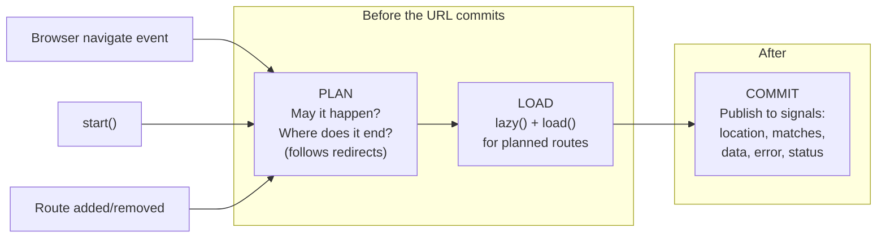

# @std-ui/router — design

Client-side router for std-ui. Standards-first: **Navigation API**, signals, custom elements.

## Mental model

**A navigation is a transaction: Plan → Load → Commit.**



- **Plan** (`plan.ts`): redirects, `beforeLeave` hooks, route guards. Result: `go(to, matches)` or `block`. `to` differs from the request when a redirect was followed.
- **Load** (`loader.ts`): `lazy()` then `load()` per matched route, in parallel.
- **Commit** (`Router#commit`): the only place that writes the router's signals.
- **Transaction** (`transaction.ts`): one attempt, one abort signal. A newer navigation, `stop()`, or the browser aborting the event makes it *stale*; a stale transaction never commits.
- **Entry points**, all running the same steps: (1) the browser `navigate` event (Plan in `precommitHandler`, Load + Commit in `handler`); (2) `start()` and route registration (`#reresolve`, no event).

Everything else is a helper for one step: `RouteTable` (what routes exist), `BasePath`, `LeaveHooks`, the matcher, and the precommit shim (platform gap).

## Decisions

| Area | Decision | Why |
|---|---|---|
| Package | Separate `@std-ui/router`; peer `@std-ui/core` | Apps without routing pay nothing. `ext` stays small. |
| Navigation | **Navigation API required** (`window.navigation`). No History API fallback. `new Router()` throws without it. | One code path. The `navigate` event replaces link interception, popstate bookkeeping and scroll/focus code. |
| SSR | Out of scope | Keeps the matcher and elements DOM-only. |
| Route sources | Config table (`createRouter({ routes })`), `<std-route>` markup, or both | Markup suits the no-compiler browser bundle. Config suits typed apps. Both compile to the same `RouteDef` tree. |
| Matching | Own matcher (`match/matcher.ts`) | `URLPattern` is not in jsdom and not universal. A native-`URLPattern` backend is a possible later swap behind `matchRoutes`. |
| Context | Elements find the router by DOM ancestry (`findAncestor`, crossing shadow roots) | No `@std-ui/ext` dependency. A context-based lookup can replace it later without API change. |

## What the Navigation API gives us

- **No link interception.** The `navigate` event fires for `<a>` clicks, form GETs, `location` changes, back/forward and `navigation.navigate()`. The router calls `event.intercept({ handler })` for same-origin, non-hash, non-download navigations inside `base`.
- **Scroll and focus** are handled by the browser when the intercept handler's promise settles. No custom scroll restoration.
- **Cancellation**: `event.signal` aborts when a newer navigation starts. Each `Transaction` links its own signal to it, so "stale" is just `signal.aborted`.
- **Redirects** use `controller.redirect(url, { history: 'replace' })` in `precommitHandler`. Redirects the router starts without an event (`start()`, route changes) use `navigation.navigate(..., { history: 'replace', info })`; the `info` marker (`REDIRECT_INFO`) tells the next plan to skip `beforeLeave` hooks.
- **Programmatic API** (`router.navigate/back/forward`) is a thin wrapper over `navigation.*`.

### Guards and `precommitHandler`

Redirect attributes, `beforeLeave` hooks and route guards run in one place: the router's `precommitHandler`, as the Plan step (`planNavigation`). A block rejects, which cancels the navigation before the URL commits. A redirect is followed inside Plan (hops capped), then applied once with `controller.redirect()`. The router contains no other path.

Native support is limited (checked Nov 2026): Chrome/Edge 146+, Firefox 148+, **no Safari**. `shim/precommit-shim.ts` (`withPrecommit`) papers over that so router code is written only against the native API:

| Engine | What happens |
|---|---|
| Native `NavigationPrecommitController` | `withPrecommit` returns `navigation` untouched. |
| Otherwise | The shim wraps `navigation`. `precommitHandler` runs as the first step of `handler` (after commit); a rejection reverts the entry (`traverseTo(prevKey)` / `back()` / `navigate(prevUrl, replace)`) and rethrows; `redirect()` re-navigates with `history: 'replace'` and runs the original `handler` for the target. Navigations the shim starts are hidden from the router's listener. Events are presented as cancelable so the router needs no special case. |

Still inside the Navigation API, not a History fallback. Delete the shim when Safari ships `precommitHandler`. Tests run both modes by stubbing the `NavigationPrecommitController` global.

### `beforeLeave(hook)`

`router.beforeLeave(({ from, to, signal }) => boolean | void | Promise<...>)` returns an unregister function. `false` blocks. Hooks run before route guards, only for router-handled navigations (not the initial resolve or re-resolves after route registration), and once per user navigation even if a guard redirects. The router has no dependency on `@std-ui/ext`; a dirty-form guard is one line against ext's change tracking:

```ts
const form = changes(state({ name: '' }));
router.beforeLeave(() => !form.changes.dirty.peek() || confirm('Discard changes?'));
```

#### Tab close / reload

Tab close, reload and cross-origin navigation never reach the Navigation API's intercept, and `beforeunload` is synchronous with no custom UI, so the async hook cannot serve it. Pass a sync predicate instead:

```ts
router.beforeLeave(
  () => !form.changes.dirty.peek() || confirm('Discard changes?'),
  { unload: () => form.changes.dirty.peek() },
);
```

While the router is started and any registered hook's `unload()` returns true, the router calls `preventDefault()` (and sets `returnValue = ''`) on `beforeunload`, so the browser shows its generic prompt. The listener is attached only while started and at least one hook has an `unload` check, and removed on unregister or `stop()`.

## Route model

```ts
interface RouteDef {
  path?: string;          // relative to parent: 'users', ':id', ':id?', '*'
  index?: boolean;        // matches parent path exactly
  element?: string;       // tag name rendered by <std-outlet>
  template?: HTMLTemplateElement; // static content when no element
  lazy?: () => Promise<unknown>;  // awaited before commit (dynamic import)
  load?: (ctx) => unknown;        // result exposed via router.data()
  guard?: (ctx) => boolean | string | void | Promise<...>; // false blocks, string redirects
  redirect?: string;      // ':param' substituted
  errorElement?: string;
  title?: string;
  meta?: Record<string, unknown>;
  children?: RouteDef[];
}
```

Ranking among siblings: `index` first, then per segment static > `:param` > `*`; ties keep declaration order.
All paths given to the router API (`navigate`, `redirect`, guard results) are **app-relative** (no `base`). `base` is added and stripped at the Navigation API boundary.

## Pipeline in detail

1. **Plan** (`planNavigation`, loops over redirects): match the pathname into a root-to-leaf chain (empty chain = not found); `beforeLeave` hooks run first (first hop only, even when the target is a redirect); a matched `redirect` follows its target; route guards run root to leaf (`string` redirects, `false` blocks). Anything that throws (guard, hook, redirect limit) becomes `go` with `error` set, so the navigation still commits and `errorElement` renders. A loop error keeps the requested URL.
2. **Load**: `lazy()` then `load()` for every planned route in parallel; skipped when Plan already carries an error. A thrown error is kept, not rethrown.
3. **Commit**, unless stale: publish `location`, `matches`, `data`, `error`, `status` and `document.title`. An error commits with `status = 'error'`. In dev, an empty match warns once per path (`dev/warn.ts`). A navigation that ends without committing (blocked) settles `status` back to the committed state, so `'loading'` never sticks.

State is signals (`location`, `matches`, `data`, `error`, `status`, computed `params`).

## Module layout (`src/router/`)

| File | Step / role |
|---|---|
| `router.ts` | Public facade and the two entry points (browser `navigate` event, `start`/route changes). No logic of its own beyond wiring. |
| `pipeline.ts` | Plan → Load → Commit steps and the "latest transaction wins" rule. Browser-agnostic. |
| `state.ts` | The signals; `commit` is their only writer. |
| `plan.ts` | **Plan**: follows redirects to a final `go` / `block`; `REDIRECT_INFO` marker. |
| `guards.ts` | One check of a location: redirect attrs, `beforeLeave`, route guards → `Verdict`. |
| `loader.ts` | **Load**. |
| `transaction.ts` | One attempt and its abort signal (stale = aborted). |
| `route-table.ts` | Which routes exist (config + runtime-registered); notifies on change. |
| `leave-hooks.ts` | `beforeLeave` registry and the `beforeunload` prompt. |
| `base-path.ts` | `base` stripping/adding. |
| `abort.ts` | AbortError helpers. |

Matching lives in `match/`, the Navigation API type view in `navigation/`, the `precommitHandler` shim in `shim/`, test support in `dev/`.

## Elements

```html
<std-router base="/app">
  <std-route path="/" element="home-page"></std-route>
  <std-route path="/users" element="users-layout">
    <std-route index element="users-index"></std-route>
    <std-route path=":id" src="/pages/user-page.js" element="user-page"></std-route>
  </std-route>
  <std-route path="/about"><template><h1>About</h1></template></std-route>
  <std-route path="/old" redirect="/users"></std-route>
  <std-route path="*" element="not-found-page"></std-route>
  <std-outlet></std-outlet>
</std-router>
```

- `<std-router>`: owns the `Router` (lazy `router` getter). Properties `routes` and `navigation` must be set before connecting. Starts in a microtask so child `<std-route>`s register first.
- `<std-route>`: inert (`hidden`). Builds its `RouteDef` lazily (`def`) so a child can reach its parent's def before the parent connects. Attributes are read once. Behaviour via properties: `guard`, `load`. Attributes: `path`, `index`, `element`, `src`, `redirect`, `error-element`, `title`, `meta-*`, child `<template>`. Registers on connect, unregisters on disconnect; the router re-resolves in a microtask.
- `<std-outlet>`: depth = number of ancestor outlets. Renders `matches()[depth]`, reusing the element while the route and tag are unchanged and updating its `params`, `data`, `error`, `route` properties.
- `@routeParam(name?)` / `@searchParam(name?)` (`element/param-decorators.ts`): field decorators that register into class metadata. On connect, a hook finds the ancestor `<std-router>` and defines a read-only getter over `router.params()` / `router.location().search`, so reads are reactive. They throw without an ancestor router.
- Define order matters: `<std-router>` before the others (see `element/index.ts`; listed in `sideEffects`).

## Testing

jsdom has no Navigation API. `createMemoryNavigation()` implements the subset in `navigation/types.ts` (commit-before-handler, abort on supersede, `traverseTo`) and is passed as `navigation` to `createRouter` / `<std-router>`. All test-support code lives in `src/dev/`; its `index.ts` is the `@std-ui/router/testing` entry and is never re-exported from the main entry. It approximates the spec, so revert/abort behaviour is unverified in a real engine (see roadmap).

## Roadmap

- [x] Matcher, nested/index/redirect, ranking
- [x] Router core on Navigation API: signals, guards, loaders, cancellation, revert, `base`
- [x] `<std-router>`, `<std-route>`, `<std-outlet>`
- [x] `beforeLeave` hooks; `precommitHandler` when supported (revert path otherwise)
- [x] `beforeunload` guard for tab close / reload (`beforeLeave(hook, { unload })`)
- [x] `@routeParam` / `@searchParam` decorators (built on `core` only, no `ext` needed; named to avoid `query`, taken by DOM query decorators)
- [x] Error handling in Plan (guard/hook/redirect-limit errors commit an error state); `status` never sticks on `'loading'`; dev warning for unmatched paths; package build verified (`tsc` + bundles)
- [x] Live-region announcer (`announce`, `router/announcer.ts`), view transitions (`viewTransition`, `router/view-transition.ts`); both run around Commit in `Pipeline#load`, skip the initial load, and are opt-out / opt-in respectively
- [x] Demo section under `demo/feature-demo/sections/router/` (`router.html`: announcer, view transitions; in-memory navigation)
- [ ] Real-browser test run (vitest browser mode) to validate guard revert and supersede against a real Navigation API
- [ ] Optional `URLPattern` backend; context-based router lookup
