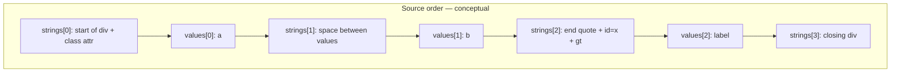
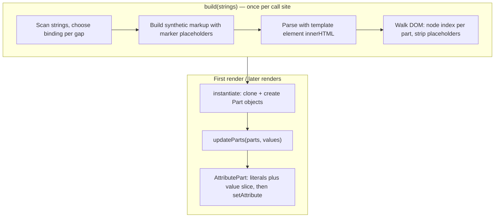
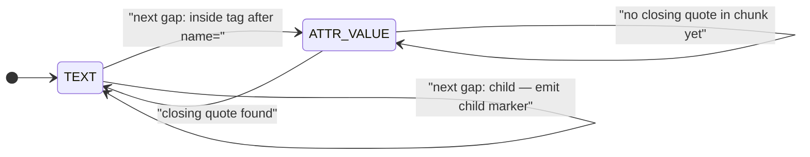
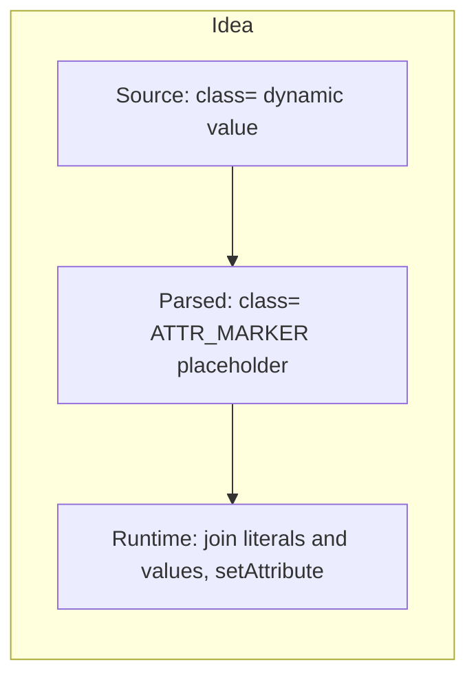
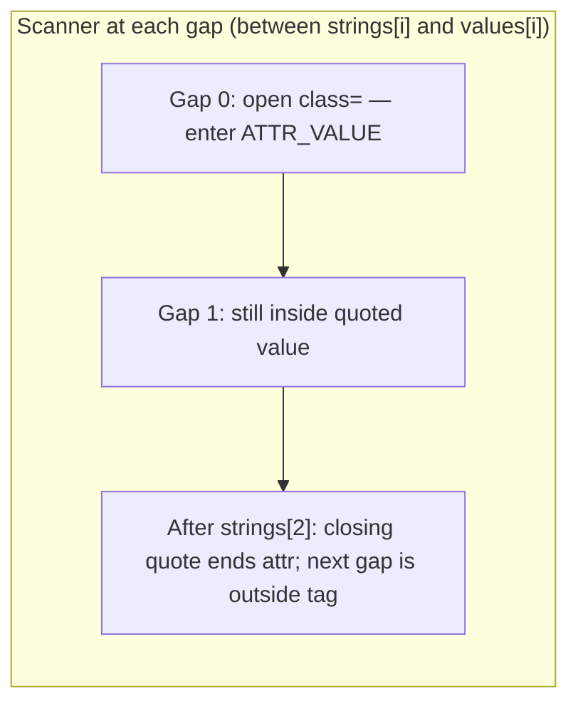
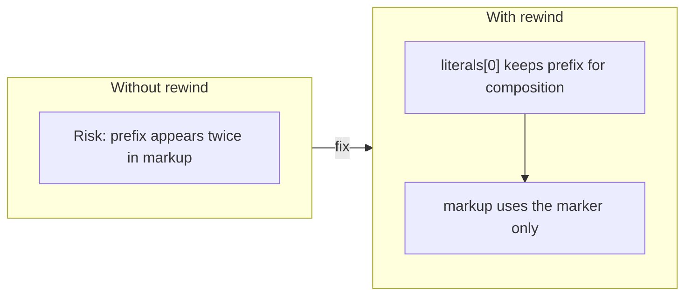
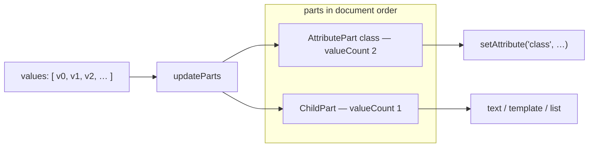

# How attribute building works

This doc focuses on **plain attributes** (no `?`/`.`/`@` prefix): values that end up as strings via `setAttribute`. The scanning lives in the generic `builder.ts`; the attribute *syntax* (sigils, one-interpolation rules) lives in `factory.ts` and is plugged in through hooks (see [design.md](./design.md)). `AttributePart` and `updateParts` in `parts/` apply the built result at runtime.

If you only read one diagram, use [the state machine](#scanner-two-states) and [the end-to-end pipeline](#end-to-end-pipeline).

---

## Tagged template → what The factory sees

When you write:

```ts
t`<div class="${a} ${b}" id="x">${label}</div>`;
```

the Builder gives `t()` two parallel arrays:

| | |
|---|---|
| `strings` | Static text between each `${...}`, in order |
| `values` | Each expression result, in the same order |

Conceptually, **static** and **dynamic** pieces alternate in source order (conceptually — `strings` holds all static segments; `values` holds each `${...}`):



The factory **never** looks at `values` while building. It only walks `strings` and figures out **how many** consecutive `values` each “part” will need (`valueCount`) and, for attributes, the **static pieces** (`literals`) between them.

---

## End-to-end pipeline



- **build** produces a cached `Template` (parsed DOM shape + `PartDescriptor[]`).
- **Instantiate** clones that fragment and binds `Part` instances to real nodes.
- **updateParts** slices `values` according to each part’s `valueCount` (attributes with multiple `${...}` consume more than one value).

---

## Scanner: two states

The attribute logic is a small **finite-state scanner** over the gaps between `strings[i]` and `strings[i+1]` (each gap is “one interpolation will go here”). Think of it like a tokenizer: either you are in normal markup, or inside a quoted attribute value.



Rough meanings:

| State | “We are…” | Next interpolation is… |
|--------|------------|-------------------------|
| **TEXT** | Outside an open quoted attribute value | Either a **child** binding, or the **first** piece of an attribute value (right after `name="`). |
| **ATTR_VALUE** | Inside `name="…` until the matching `"` or `'` | **Another segment of the same attribute** (more static text and/or another `${...}`), until the closing quote. |

The Builder uses `stepText` / `stepAttrValue` for transitions; see `builder.ts`. It calls the `onAttributeOpen` hook at the `TEXT -> ATTR_VALUE` transition and `onAttributeClose` at `ATTR_VALUE -> TEXT`.

---

## Placeholder markup the HTML parser can eat

Dynamic attribute **values** are not left as real text in the template fragment. The factory inserts a single fake attribute value **`std-ui-part`** (the Builder's `MARKER`, shared with the child-slot comment) on the element so that, after parsing, the walk can find “this element + attribute name = one AttributePart”. The real string is **rebuilt at runtime** from `literals` + the matching slice of `values`.



So building answers: **which element**, **which attribute name**, **which literal segments**, **how many values**.

---

## Example A: two interpolations in one attribute

Template:

```ts
t`<div class="${a} ${b}"></div>`;
```

**Literals** recorded for `class` mirror the static pieces between values: roughly `['', ' ', '']` (empty before first value, space between, empty after second). **valueCount** = 2.



At runtime, `AttributePart` computes:

`class = literals[0] + a + literals[1] + b + literals[2]` → e.g. `"btn active"` if `a === 'btn'`, `b === 'active'`.

---

## Example B: static text before the first `${...}`

Template:

```ts
t`<div class="static-${x}"></div>`;
```

The characters `static-` appear in `strings` **before** the first gap. The scanner stores them in `literals[0]` for composition, but they must **not** stay in the synthetic markup string, or you would get **duplication** when the real value is applied. So when opening the attribute, The factory **rewinds** the last few characters of the accumulated markup (the length of that prefix) before continuing. That “rewind” is the subtle bit: one copy in `literals`, one placeholder in the parse tree, no double `static-` in the fragment.



---

## Plain vs sigiled attributes

| Style | Example | Build-time rule |
|--------|----------|-------------------|
| Plain | `class="${a} ${b}"` | Allowed: string composition, multiple `${...}`, static mix. |
| Boolean | `?hidden=${v}` | Exactly **one** interpolation, **no** extra static text in the value. |
| Property | `.value=${v}` | Same. |
| Event | `@click=${fn}` | Same (plus optional `.modifier`s on the **name**, see [grammar](#binding-name-grammar)). |
| Class / style | `class.active=${on}`, `style.color=${c}` | Same. |

Sigiled kinds bind a **single JS value** (boolean, property, listener), not a composed string, so The factory rejects multiple interpolations or static glue inside the quoted value.

### Unquoted values

Any attribute kind may drop the quotes when it has a single interpolation: `class=${x}`, `.value=${v}`, `?hidden=${v}`, `@click=${fn}`. The Builder detects `name=` at the end of the markup (inside a tag), calls `onAttributeOpen` with an empty quote/prefix, and immediately closes the attribute with `literals = ['', '']` and `valueCount = 1`, so no ATTR_VALUE state is entered. A quoted placeholder (`"std-ui-part"`) is emitted so the HTML parser sees a valid attribute. Static text or several interpolations require quotes: `class="a ${b}"`; `class=a-${x}` treats `a-` as a literal and is rejected.

Division of labour: the Builder hands the hooks the attribute's raw name (sigil and modifiers included, e.g. `@click.once`). `onAttributeOpen` in `factory.ts` parses it into kind/name/options, and `onAttributeClose` receives `literals` and `valueCount` and throws for sigiled kinds that break the rule above. The Builder itself has no notion of sigils.

---

## Binding name grammar

The attribute *name* (everything before `=`) follows one grammar for every kind. The Builder hands
it over raw; `parseBinding` in `factory.ts` parses it.

```
binding   := sigil? name ( ":" arg )? modifier* ( "=" value )?   // name:arg is reserved
sigil     := "." | "?" | "@"            // prop | bool | event; none = plain attr
modifier  := "." ident ( ":" value )?
ident, arg, value := [\w-]+              // static only; no "." (it starts the next modifier)
```

Only a *leading* `.` is a sigil; every later `.` starts a modifier. Examples:

| Source | Kind | Meaning |
|---|---|---|
| `@click.once.capture=${h}` | event | `addEventListener` options |
| `@submit.prevent.stop=${h}` | event | `preventDefault()` / `stopPropagation()` before the handler |
| `@click.stop-immediate=${h}` | event | `stopImmediatePropagation()`: also blocks later listeners on the same element |
| `@click.self=${h}` | event | handler only runs when `target === currentTarget` |
| `class.active=${on}` | attr (`active` is the entry) | `classList.toggle('active', Boolean(on))` |
| `style.--gap=${v}` | attr (`--gap` is the entry) | `style.setProperty('--gap', v)`; nullish/`false` removes it |

Rules:

- The parser is generic: it produces `{ sigil, name, arg?, modifiers }` and never decides what the
  pieces *mean*. A **custom attribute** (`factory/custom-attribute.ts`) owns one `(sigil, name)` pair: it
  validates the binding at build time and builds the `Part`. Register with
  `registerCustomAttribute()` before the template is first built (templates are cached).
  The native kinds are Custom attributes too (`custom-attributes/*/*.custom-attribute.ts`): plain attribute, `.prop`, `?bool` and
  `@event`, each registered for its sigil with the wildcard name `*`. An exact `(sigil, name)`
  extension wins when its `matches()` accepts the binding, otherwise the sigil's wildcard applies. A new
  sigil (e.g. `#name:arg.mod:value="a ${x}"`) is just another registration; mixed text and several
  interpolations are allowed by default; `single: true` requires exactly one interpolation. An unregistered sigil throws at build time.
- `class` and `style` entries are Custom attributes that live in `@std-ui/ext` (`element/template/custom-attributes/class-style/class-style.custom-attribute.ts`;
  importing the package registers them, core does not): they accept **exactly one** modifier as the entry (`class.active`, `style.color`,
  `style.--gap`); more than one, or a `:value` on it, throws. With no modifier, `class=${x}` is
  the plain attribute. Entry bindings are single-value (one interpolation, no static text). Use
  kebab-case for style properties; `!important` and the like belong in the bound value.
- `name:arg` is part of the grammar but **reserved**: it is carried as `arg` on the descriptor and
  only a custom attribute may accept it; anywhere else it throws at build time.
- The descriptor always carries the parsed `modifiers: { name, value? }[]`. Each kind then
  interprets the ones it knows: `EventPart` (`parts/event-part.ts`) receives the raw `modifiers`
  and turns `capture`/`once`/`passive` into `addEventListener` options and
  `prevent`/`stop`/`stop-immediate`/`self` into handler filters. Each part warns about modifiers it doesn't support (`warnIgnoredModifiers` in
  `parts/part.ts`): DEV only, once per distinct message, logged when the part is first created
  rather than at build time. Unsupported modifiers have no other effect.
- Static values only, for now. Modifier values are Build-time strings (`.debounce:300` would be
  `{ name: 'debounce', value: '300' }`; no kind consumes it yet).

### Not supported yet: dynamic args (`:${value}`)

`@input.debounce:${ms}=${h}` needs an interpolation *inside the attribute name*, which the HTML
parser cannot carry. It would need a third scanner state in `builder.ts` that swaps in-name gaps for
unique placeholder names, raises `valueCount` for the part, and has `EventPart` diff its options
each update. Names are also lowercased by the HTML parser for markup, but we parse from the raw
`strings`, so case is preserved in `name` and modifier names.

---

## Descriptor → `Part` → DOM

For each attribute binding, `PartDescriptor` carries:

- `kind: 'attr'`, `name` (e.g. `'class'`)
- `literals`: static segments, length = `valueCount + 1`
- `valueCount`: how many entries to take from `values` in order



---

## Files to read in the repo

| File | Role |
|------|------|
| `builder.ts` | Generic: scan `strings`, build synthetic markup, node indexing, `getTemplate`, `instantiate`, hooks |
| `factory.ts` | std-ui syntax: sigils, descriptor kinds, `createPart`, SVG, dev warnings |
| `design.md` | Builder/hook architecture |
| `parts/attribute-part.ts` | `AttributePart` |
| `parts/part.ts` | `updateParts` |
| `render.ts` | Root `render()` calling `updateParts` |

---

## Related

- Overview for users: [html.md](../tag-funcs/html/html.md) (binding table, limitations).
- Architecture: [design.md](./design.md).
- Implementation comments at the top of `builder.ts` and its `ScanState` / `stepText` / `stepAttrValue` helpers.
