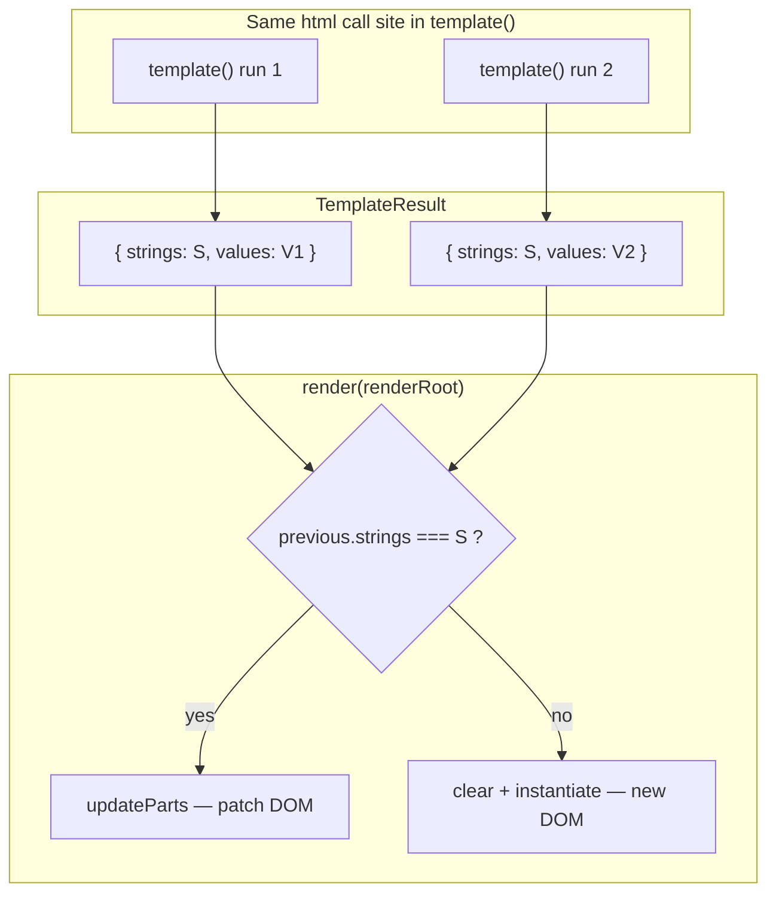

# Saved re-rendering (tagged templates + `UIElement`)

When state changes, `UIElement` calls `template()` again and gets a **new** `TemplateResult` each
time. That sounds like a full re-render, but it usually is not: the engine reuses the existing DOM
and only patches **values** that changed. This document explains that contract — the same idea
[lit-html](https://lit.dev/docs/templates/expressions/) calls out, wired through std-ui's
`UIElement` and `render()`.

If you already use signals + `t` from [`signal-drives-html.md`](./signal-drives-html.md), you
get this behavior for free. This page zooms in on **why** it works and **when** it does not.

## Two objects, two meanings of "template"

Every `t\`...\`` call produces a plain object:

```ts
{ strings: TemplateStringsArray, values: readonly unknown[] }
```

| Piece | What it describes | Stable across signal updates? |
|---|---|---|
| **`strings`** | Static markup shape: tags, attribute names, how many `${...}` slots exist | **Yes** — same *call site* → same array **reference** |
| **`values`** | Current dynamic data: text, classes, handlers, nested `t` results | **No** — new array every `template()` run |

`template()` returning again does **not** mean the browser parsed your HTML again. It means you
built a fresh result bag with new `values`. The **shape key** is `strings`, not the outer object
identity.

## JavaScript guarantees the cache key (`strings` identity)

For a given tagged-template **call site** in source (one `` t`...` `` expression at a fixed
location), the engine passes the **same** `TemplateStringsArray` object on every invocation. That
is specified behavior — not a std-ui trick.

```ts
const view = (name: string) => t`<p>${name}</p>`;
view('Ada').strings === view('Grace').strings; // true — same call site
```

Different call sites — even with identical-looking markup — get **different** `strings`:

```ts
t`<p>${1}</p>`.strings === t`<p>${1}</p>`.strings; // false
```

So in a component:

```ts
protected override template() {
	return t`<span>${this.count()}</span>`;
}
```

Every signal-driven re-entry of `template()` yields a new `TemplateResult`, but the `return t\`...\``
line is always the **same call site**, so `result.strings` is unchanged. That is what enables saved
re-rendering.

## What `render()` does

`render(result, container)` keeps a small record per container (`render.ts`): last `strings`
reference and the bound `Part[]` list.

```
previous.strings === result.strings ?
  yes → updateParts(parts, result.values)   // patch only
  no  → clear container, compile, clone, bind, then updateParts
```

Important details:

- The check is **`===` on the `strings` object**, not a deep compare of each static segment and not
  a scan of `values`.
- **First** render into a container has no `previous` → full setup once (compile is cached globally
  by `strings` anyway).
- **`values` are always applied** on the fast path — via `updateParts`, which forwards to each
  `Part.update`. Parts no-op when `Object.is` says the value did not change (aligned with
  `signal.set`).

The global compile cache (`getTemplate(strings)`) and per-container part list work together:
compile once per call site, clone once per container, patch forever on that site.

## `UIElement`: `template()` on every signal read, cheap DOM most of the time

On connect, `UIElement` registers a render `effect` that:

1. Calls `this.template?.()`.
2. If the return value is a `TemplateResult`, calls `render(result, this.renderRoot)`.

When any signal `template()` **read** changes, step 1–2 run again. You always allocate a new
`TemplateResult`; `render()` still sees the same `strings` for a stable `return t\`...\`` and
takes the patch path.

```
Signal write
  → render effect runs
  → template() → new { strings, values }
  → render: strings unchanged → updateParts only
```

`firstRendered` / `rendered` still run after each pass; only the **DOM work** is minimized.

This is **not** virtual DOM diffing. There is no tree of VNodes — only a fixed list of binding
sites (`Part`s) created the first time that `strings` was rendered into that container.

## Nested templates and lists (same rule, smaller scopes)

Each `` t`...` `` expression is its own call site with its own saved re-render.

**Nested child template** (one `${...}` slot holds another `t` result): `ChildPart` applies the
same `strings ===` rule for the subtree it owns (`parts/child-part.ts` `#commitTemplate`). Parent outer
`strings` stay the same; the nested slot updates its inner template independently.

**Arrays in child position** (`${items.map(...)}`): the parent part sees an array `value` and
manages a **positional** list of child parts (grow/shrink by length). Each mapped `` t`...` `` is
still one call site reused for every row — not one `strings` per row.

```ts
t`
  <ul>
    ${this.todos.map(todo => t`
      <li>${todo.text}</li>
    `)}
  </ul>
`;
```

- Outer `` t`...` `` → one `strings` for the whole component shell.
- Inner `` t`...` `` inside `.map` → one `strings` for every `<li>...</li>`, shared across
  iterations.
- List changes (add/remove/reorder) update rows **by index** — no keyed reconciliation (see
  [`../template/html.md`](../template/html.md#limitations-vs-real-lit-html)).

Prefer **conditional values** inside one template over **conditional templates** when you want to
keep a single call site:

```ts
// Good for reuse — one call site, class/text change
t`<div class="${open ? 'open' : ''}">${label}</div>`;

// Full rebuild when branch changes — different call sites
open ? t`<div class="open">${label}</div>` : t`<div>${label}</div>`;
```

For conditional **fragments** without switching the outer template, nest `t` in `${...}`:

```ts
t`
  <button>
    ${loading ? t`<spinner-icon></spinner-icon>` : 'Submit'}
  </button>
`;
```

The button's outer `strings` stay stable; only the child part swaps text vs nested template (nested
part may rebuild if the inner `strings` identity changes between branches).

## When saved re-rendering is **lost** (full container rebuild)

`render()` clears `container.textContent` and instantiates fresh DOM when:

| Situation | Why |
|---|---|
| First render into this container | No stored `previous` yet |
| `result.strings !== previous.strings` | Different call site or different `` t`...` `` branch |
| Different container | `WeakMap` is per `Element` / `DocumentFragment` |

Common author mistakes:

- **`if` / `else` each return their own `` t`...` ``** — toggling the condition swaps `strings`
  and tears down the tree under `renderRoot`.
- **Factory that returns a template from a *different* literal per call** — same idea.
- **Manually constructing `{ strings, values }`** without using the real call-site array — unless
  you reuse the true `TemplateStringsArray`, identity will not match.

Switching **`svg` vs `t`** for the same literal text still uses the same `strings` identity, but
compile cache keys also include `type`; stick to one tag function per call site.

## Mental model



**Call site** = shape fingerprint (`strings`). **Signal update** = new data (`values`). **Saved
re-rendering** = same fingerprint → same DOM nodes and `Part`s, update values only.

## Related reading

- [`signal-drives-html.md`](./signal-drives-html.md) — Patterns A/B/C: signals, `UIElement`,
  lifecycle, when to use `this.effect()` instead of whole-template updates.
- [`../template/html.md`](../template/html.md) — bindings, `render()`, limitations, nested lists.
- [`../template/html.ts`](../template/html.ts) — module header comment (design overview).
- [`../template/render.ts`](../template/render.ts) — container fast path.
- [`../ui-element.ts`](../ui-element.ts) — `#requestUpdate` and render effect wiring.
- [`../template/html.test.ts`](../template/html.test.ts) — tests for `strings` identity across
  calls at the same site.
