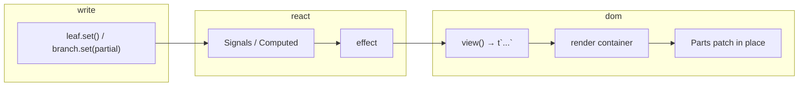

# Signals driving HTML template render

std-ui pairs two ideas that stay useful on their own but work especially well together:

1. **Signals** — fine-grained reactivity (`state`, `computed`, `effect`, or app-shaped state like `appState`).
2. **`t` + `render`** — lit-html-style tagged templates that patch the DOM in place instead of rebuilding it.

Wiring them up gives you declarative UI that updates surgically: when state changes, only the DOM nodes and attributes whose bound values actually changed are touched. No virtual DOM, no full `innerHTML` refresh on every tick.

## Why this combination is good

| Concern | What you get |
|---|---|
| **Updates** | `render()` reuses the same DOM nodes; `Part.update()` no-ops on `Object.is`-equal values (same rule as `signal.set`). |
| **Dependencies** | An `effect` re-runs only when signals it *read* change; branch changes in `computed`/`if` are tracked correctly each run. |
| **Batching** | Multiple synchronous `.set()` calls in one turn collapse to one effect flush (microtask), then one render pass. |
| **Authoring** | Markup stays in `t\`...\`` templates with attribute/event bindings; state stays in signals, not scattered DOM queries. |
| **Components** | `UIElement` already connects a `SignalState` to `template()` for you; you can still drop to raw `effect` + `render` outside custom elements. |

The fireworks app uses this throughout `src/ui/components/` — e.g. `pause-button` swaps icon markup when `appState.paused()` changes, and `controls-bar` toggles layout classes from `appState` while composing child custom elements in one template.

## Pattern A — Standalone: `effect` + `render` + signals

Use this for a widget, panel, or one-off view that is not a custom element. The effect is the "render loop": read signals, build a template result, pass it to `render`.

```ts
import { state, computed, effect, t, render } from '../index.js';

const count = state(0);
const label = computed(() => (count() === 1 ? 'click' : 'clicks'));

const container = document.getElementById('app')!;
const view = () => t`
	<p>You have <strong>${count()}</strong> ${label()}.</p>
	<button ?disabled=${count() >= 10} @click=${() => count.update(n => n + 1)}>
		Increment
	</button>
`;

effect(() => {
	render(view(), container);
});

count.set(3); // effect re-runs → render patches text + disabled, same <p> and <button> nodes
```

Important details:

- **`view` must keep the same `t` call site** — always `return t\`...\`` from the same tagged template expression. If you switch to a *different* template literal (e.g. alternate `if` branches that each define their own `` t`...` ``), std-ui tears down and rebuilds that container's DOM. Prefer one template with conditional *values* (`?disabled`, ternary in `${...}`) over conditional *templates* when you care about reuse. See [`saved-ui-rerendering.md`](./saved-ui-rerendering.md) for the full mental model (`strings` vs `values`, nested templates, lists).
- **`computed` for derived text** — keeps the effect from manually syncing extra fields; only re-read when dependencies change.
- **Event handlers** — `@click` bindings are re-bound when the handler reference changes; inline arrows are fine for demos, stable references are better in production.

## Pattern B — `UIElement`: `template()` reads signals directly → automatic `render`

For custom elements, you usually don't call `effect` + `render` yourself. Subclass `UIElement` and return `t` from `template()`, reading whatever signals you need directly inside it (module-level signals, a shared `state()` tree, or app-wide state like `appState` - `UIElement` itself has no notion of "the" state). `connect()` runs **before** the first `template`, so markup from your template is not in the DOM yet — put bindings and structure in `template`, and use `firstRendered` / `rendered` when you need to touch rendered nodes.

```ts
import { state, tag, t, UIElement } from '../index.js';

interface DemoState {
	counter: {
		value: number;
		max: number;
	};
}

const shared = state<DemoState>({
	counter: { value: 0, max: 10 },
});

@tag('demo-counter')
class DemoCounter extends UIElement {
	protected override template() {
		const { value, max } = shared.counter;
		return t`
			<span>${value()}</span> / ${max()}
			<button
				type="button"
				?disabled=${value() >= max()}
				@click=${() => shared.counter.value.update(n => n + 1)}
			>+</button>
		`;
	}

	protected override firstRendered(): void {
		// Rendered light DOM exists now — safe to query children (not in `connect()`).
		this.querySelector('span')!.setAttribute('aria-live', 'polite');
	}
}

document.body.appendChild(document.createElement('demo-counter'));

shared.counter.value.set(5);           // write a leaf: shared.counter.value is a Signal
shared.counter.set({ max: 20 });     // or set a branch without touching sibling leaves
```

Nested objects become branch `Computed`s; leaves like `value` and `max` are writable `Signal`s on the tree (`shared.counter.value.set(...)`) and are also readable as tracked functions (`shared.counter.value()`). Reading any of them inside `template()` registers that leaf as a dependency of the render effect — same tracking rule as any other `effect()`. See [`../signal/signal-state/README.md`](../signal/signal-state/README.md) for branch `.set(partial)` and `.peek()`.

What `UIElement` does for you (see `ui-element.ts`):

1. On **connect** (insertion into the document), runs `connect()` once for that connection cycle — **before** the first `template` — for host-only setup (attributes on `this`, timers, `this.effect()`). Do not assume rendered children exist yet.
2. Registers a render **`effect`** that calls `template()`, and if the result is a `TemplateResult`, passes it to `renderHtml(result, this)`. Whatever signals `template()` reads become that effect's dependencies.
3. After each render pass in that effect, calls **`firstRendered()`** once (first pass only), then **`rendered()`** every pass (including the first).
4. On **disconnect**, runs `disconnect()`, disposes the render effect and any `this.effect(...)` you registered in `connect`, and resets first-render tracking so a later re-insert gets `connect()` and `firstRendered()` again.

**Lifecycle order (each connection cycle):**

| Step | Hook | When |
|---|---|---|
| 1 | `connect()` | Before first `template`; one-time setup per connect cycle |
| 2 | `template()` | Whenever a signal it read changes (and once immediately after connect) |
| 3 | DOM patch | Only if `template` returned `t\`...\`` |
| 4 | `firstRendered()` | Once, right after the first successful render pass in step 2 |
| 5 | `rendered()` | After every render pass, including the first (always after step 4 on the first pass) |

Because `UIElement` has no built-in state, the render effect only re-runs when `template()` itself reads a signal/computed — there's no implicit "whole tree" dependency; each component declares its own dependencies just by reading them.

Return `void` from `template` if you prefer imperative DOM updates (`querySelector`, `classList`, …); the same effect still runs whenever a signal it reads changes, and `firstRendered` / `rendered` still run even when you did not return a template.

Use **`firstRendered()`** when you need DOM that only exists after the first `template` (measure layout, focus a field, `querySelector`, wire third-party widgets). Use **`rendered()`** for work that must repeat after every render (sync aria attributes, notify parents). Keep **`connect()`** for setup that does not depend on rendered output (host attributes, registering `this.effect()`).

## Pattern C — Fine-grained `this.effect()` (avoid full re-render)

When only a sliver of DOM should track one signal, use `UIElement.effect()` after rendered nodes exist (typically in `firstRendered`) instead of expanding `template()`:

```ts
protected override firstRendered(): void {
	const badge = this.querySelector('.badge') as HTMLElement;

	this.effect(() => {
		badge.textContent = String(shared.unreadCount());
	});
}
```

That effect is disposed on disconnect. Prefer **Pattern B** for structure and bindings; use **Pattern C** when profiling shows whole-template re-render is wasteful (e.g. a static shell with one live number). Register `this.effect()` from `connect()` only when it does not need rendered children.

## End-to-end data flow



1. A write notifies subscribers.
2. The render `effect` runs (batched with other writes in the same tick).
3. `render(sameTemplate, container)` updates only changed parts.

## Feature checklist (demo these in the example test)

- **Text and attributes** — `${count()}`, `class=${cls}`, `?disabled=${bool}`.
- **Properties and events** — `.value`, `@click` (see `html.md` binding table).
- **Nested templates** — `t` inside `${...}` for conditional fragments without a second top-level template.
- **No-op updates** — `count.set(5)` when already `5` does not notify; DOM is not touched.
- **Derived state** — `computed(() => count() * 2)` inside the template or passed into `${...}`.
- **Fine-grained DOM** — `this.effect()` in `firstRendered` to update a node omitted from `template` (Pattern C).
- **Post-render hooks** — `firstRendered()` once, then `rendered()` on every render pass (including the first).
- **Cleanup** — disconnect the element or call the `effect` disposer; no stray updates after teardown.

## Related reading

- [`saved-ui-rerendering.md`](./saved-ui-rerendering.md) — why signal updates reuse DOM (`strings`
  identity, `render()` fast path, nested `t` in lists).
- [`../signal/core/signal.md`](../signal/core/signal.md) — primitives, tracking, batching, `peek`.
- [`../signal/signal-state/README.md`](../signal/signal-state/README.md) — `state`, branch `.set(partial)`, app-shaped state.
- [`../template/html.md`](../template/html.md) — binding kinds, limitations, `svg`, `html` (raw markup directive).
- [`signal-drives-html.example.test.ts`](signal-drives-html.example.test.ts) — executable walkthrough of Patterns A, B, and C.
