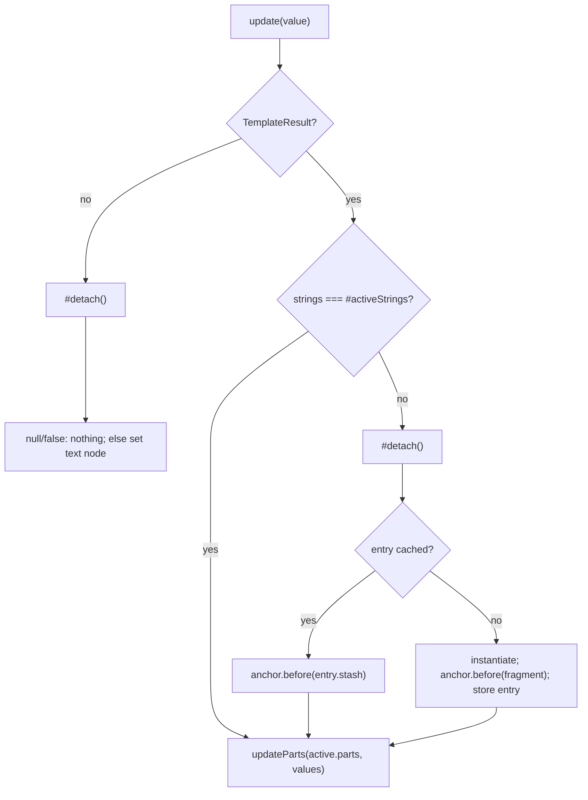

# `cache` — internal design

Implementation of the built-in child directive that keeps switched-out templates alive. Usage: [`README.md`](./README.md).

## Layout

| File | Owns |
|---|---|
| [`index.ts`](./index.ts) | `CacheDirective`, `CacheRenderer`, and `export const cache = directive(CacheDirective)`. |
| [`../index.ts`](../index.ts) | Public re-export with other directives. |

`ChildPart` has no knowledge of `cache`; the directive hands it a renderer via `renderWith()`, the same
pattern as [`../html/unsafe-html.ts`](../html/unsafe-html.ts).

## Why a renderer, not just `render()`

A plain `render()` returning the `TemplateResult` would let `ChildPart` use `TemplateRenderer`, which tears down
its DOM when `strings` change (`update()` returns `false`, `ChildPart` disposes and rebuilds). Cache needs to own
the DOM of several templates at once, so the directive returns `renderWith(CacheRenderer, value)`.

## State

One `CacheRenderer` per binding position (`ChildPart` reuses it while the directive stays the same):

- `#start` — comment inserted before `anchor` once; together with `anchor` it brackets everything this renderer
  has rendered, including content that nested child parts insert later.
- `#entries` — `Map<TemplateStringsArray, { parts, stash }>`. `parts` are the live instantiated parts; `stash` is
  a `DocumentFragment` that holds the entry's nodes while inactive.
- `#active` / `#activeStrings` — the entry currently in the DOM.
- `#text` — text node for non-template values.

## Update flow

`#detach()` moves every sibling between `#start` and `anchor` into the active entry's `stash`. Walking the
siblings, rather than remembering the instantiated top-level nodes, also catches nodes inserted by nested
`ChildPart`s at the template's top level.

## How results are cached

What is cached is the *instantiated* template (its DOM and parts), not the `TemplateResult`. A
`TemplateResult` is just `{ strings, values, type }` and is recreated on every render.

1. **Key** — `result.strings`. The `TemplateStringsArray` is the same object for every evaluation of a given `t`
   literal, so identity comparison tells whether two results come from the same template. Different literals,
   even with identical text, get different entries.
2. **Miss** — `getTemplate(strings, type)` (itself cached by the compiler) is instantiated with `instantiate()`.
   The fragment is inserted before `anchor`, and `{ parts, stash }` is stored in `#entries`.
3. **Active** — only the entry in `#active` has nodes in the live DOM. Every render calls
   `updateParts(parts, result.values)` on it; unchanged values are skipped by the parts, so re-rendering the
   same template stays cheap.
4. **Swap out** — `#detach()` moves the nodes into that entry's `stash`. The parts are not touched, so they
   keep their last committed values and any state held by directives.
5. **Hit** — switching back moves the `stash` contents before `anchor` and calls `updateParts()` with the new
   values. Only values that differ from the stashed ones are written to the DOM.
6. **Non-template value** — detaches the active entry (it stays in `#entries`) and renders text. A later
   template with a cached `strings` is still a hit.

Because the stash is a `DocumentFragment`, an entry's nodes are always in exactly one place: the live DOM
between `#start` and `anchor`, or its stash.

## Lifecycle

- **Switching** does not call `disconnect()` on stashed parts: their directives stay connected and keep their
  state.
- **`disconnect()`** (enclosing template removed, DOM left in place) disconnects parts of every cached entry.
- **`dispose()`** disconnects, detaches, clears `#entries`, and removes `#start`.
- **Constructor** — `partInfo.type === PartType.CHILD`, else throw.

## Limitations

- No eviction: each distinct `strings` stays cached until teardown.
- Stashed parts still hold their listeners/observers; only their DOM is detached.
- Only templates are cached; arrays and other directive results inside `cache()` render as text.

## Related reading

- [`README.md`](./README.md) — public API.
- [`../html/unsafe-html.ts`](../html/unsafe-html.ts) — another directive built on `renderWith()`.
- [`../../parts/renderers/child-renderer.ts`](../../parts/renderers/child-renderer.ts) — `ChildRenderer`, `renderWith`.
- [`../../parts/renderers/template-renderer.ts`](../../parts/renderers/template-renderer.ts) — the non-caching equivalent.
