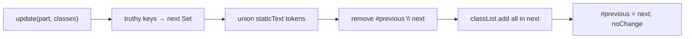

# `classMap` — internal design

Implementation of the built-in `class` attribute directive. Usage: [`README.md`](./README.md).

## Layout

| File | Owns |
|---|---|
| [`main.ts`](./main.ts) | `ClassMapDirective` + `export const classMap = directive(ClassMapDirective)`. |
| [`index.ts`](./index.ts) | Re-export. |
| [`class-map.test.ts`](./class-map.test.ts) | Behavior tests through `AttributePart` directly. |
| [`../index.ts`](../index.ts) | Public re-export with other directives. |
| [`../directives.test.ts`](../directives.test.ts) | End-to-end tests through `t()` / `render()`. |

`main.ts` does not import `../../parts/` or `../../compile.ts`; dispatch is generic — see
[`../../directive.ts`](../../directive.ts).

## Why `update()`, not `render()`

`render()` would return one string for `setAttribute`, replacing the entire `class` attribute. This
directive must diff only the classes **it** applied, leaving static markup and other sources
untouched. It overrides `update()`, mutates `part.element.classList`, and returns `noChange`.

Same overall pattern as [`../style-map/design.md`](../style-map/design.md).

## Lifecycle

1. **Constructor** — `partInfo.type === PartType.ATTRIBUTE` and `name === 'class'`, else throw.
2. **`#previous`** — `Set<string>` of class names this instance last applied (one directive instance
   per binding position, reused across re-renders).
3. **`update()`** — build `next` from truthy object keys; if `part.staticText` is set, union
   whitespace-separated tokens from the static portion of the attribute; remove `previous \ next`,
   add every name in `next`; store `next` in `#previous`; return `noChange`.

## Related reading

- [`README.md`](./README.md) — public API.
- [`../style-map/`](../style-map/) — `styleMap` (same protocol, `el.style`).
- [`../../directive.ts`](../../directive.ts) — `Directive`, `PartType`, `noChange`, `staticText`.
