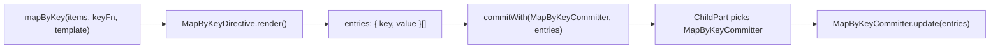

# `mapByKey` — internal design

Keyed list rendering for child positions (under an explicit name). For
usage and API, see [`README.md`](./README.md).

## Module split

| File | Owns |
|---|---|
| [`main.ts`](./main.ts) | `MapByKeyDirective`, `export const mapByKey`, duplicate-key validation, building `{ key, value }[]`. |
| [`map-by-key-committer.ts`](./map-by-key-committer.ts) | `MapByKeyCommitter`, keyed DOM create / move / remove. |
| [`index.ts`](./index.ts) | Public re-export of `mapByKey`. |
| [`map-by-key.test.ts`](./map-by-key.test.ts) | Behavior through `ChildPart` (and committer edge cases). |
| [`../directives.test.ts`](../directives.test.ts) | End-to-end through `t()` / `render()`. |

`mapByKey` does not live in `../parts/`: `ChildPart` only knows the generic `commitWith()` protocol
from [`../../parts/committers/committer.ts`](../../parts/committers/committer.ts). The directive
supplies its own committer class, same pattern as [`../unsafe-html/`](../unsafe-html/).

## Why `render()`, not `update()`

Unlike `classMap` / `styleMap`, `mapByKey` overrides **`render()`** and returns
`commitWith(MapByKeyCommitter, entries)`. The directive does not mutate the DOM itself; it prepares
keyed entries and delegates reconciliation to `MapByKeyCommitter` on each application.

## Data flow

1. **`MapByKeyDirective.render()`** walks `items`, assigns keys (`keyFn` or index), checks uniqueness,
   and maps each item through `template()` into `value`.
2. **`ChildPart`** sees `isCommitWith`, reuses or instantiates `MapByKeyCommitter` anchored on the
   part's end comment.
3. **`MapByKeyCommitter.update()`** reconciles against a `Map<key, KeyedItem>`.

## `MapByKeyCommitter` DOM model

Each logical row owns a **range** `[startComment … endComment]`:

- `start` — opening `std-ui-part` comment.
- `part` — `ChildPart` bound to `end` (the closing comment), same as other child content.

New rows insert `start` and `end` before the list anchor, then wrap the row's rendered value in that
`ChildPart`.

Reconciliation passes:

1. **Remove** keys absent from the new `entries` (`removeKeyed`: `ChildPart.dispose()` + remove
   `start`).
2. **Walk `entries` backwards**, with `ref` starting at the list anchor:
   - Missing key → create comment pair + `ChildPart`.
   - Existing key out of order → `insertBefore` the whole node range before `ref`.
   - `item.part.update([value])` either way.
   - Set `ref = item.start` for the next iteration (working back toward document start).

Backward iteration means each row is placed immediately before the row that follows it in the final
order, using a single forward reference `ref`.

## Lifecycle

| Hook | Behavior |
|---|---|
| `MapByKeyCommitter.disconnect()` | `disconnect()` on each nested `ChildPart` (directives in rows), DOM kept. |
| `MapByKeyCommitter.dispose()` | Full teardown when committer is replaced or part cleared. |
| `ChildPart` swap | If a non-`commitWith` value arrives, `ChildPart` disposes the committer. |

## Comparison with `ListCommitter`

| | `ListCommitter` (plain array) | `MapByKeyCommitter` |
|---|---|---|
| Identity | Index `i` | User key |
| Reorder | Patch value at index `i` | Move DOM ranges |
| Shrink | `pop()` extra `ChildPart`s | Remove by key |
| Grow | New anchor before list end | New comment pair per new key |

## Related reading

- [`README.md`](./README.md) — public API.
- [`../../parts/child-part.ts`](../../parts/child-part.ts) — committer selection and directive application.
- [`../unsafe-html/`](../unsafe-html/) — another `commitWith()` child directive.
- [`../../parts/committers/list-committer.ts`](../../parts/committers/list-committer.ts) — positional list diff.
