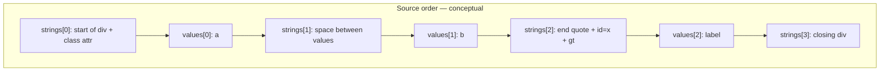
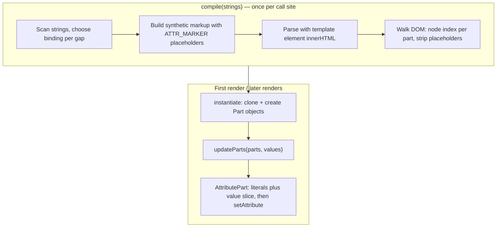
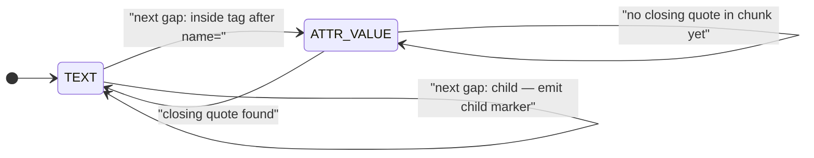
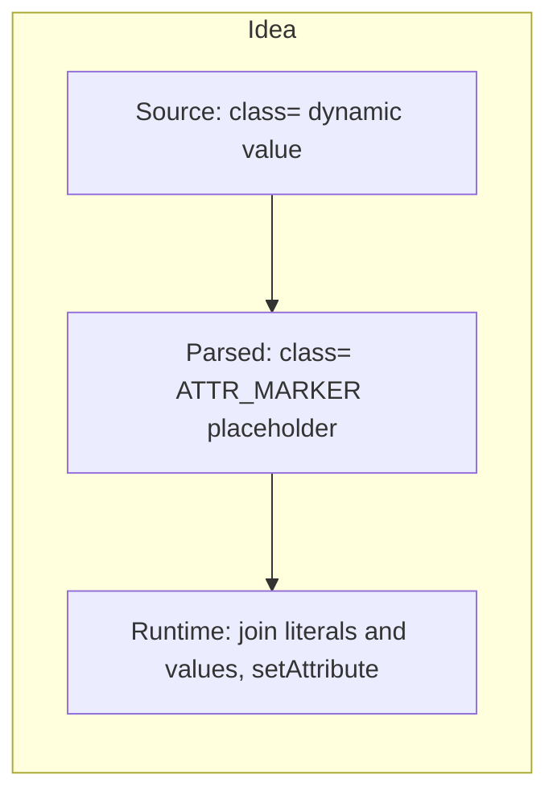
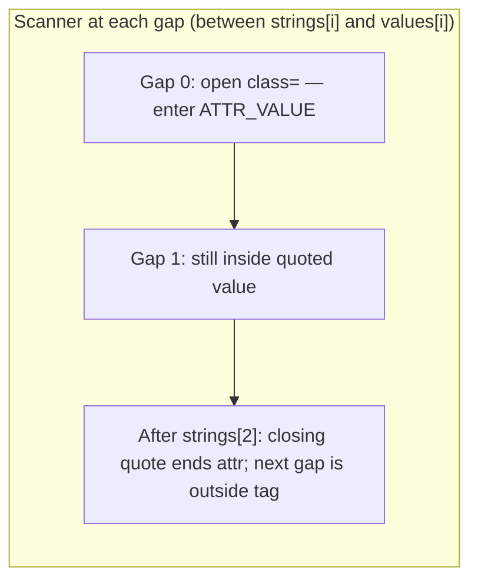
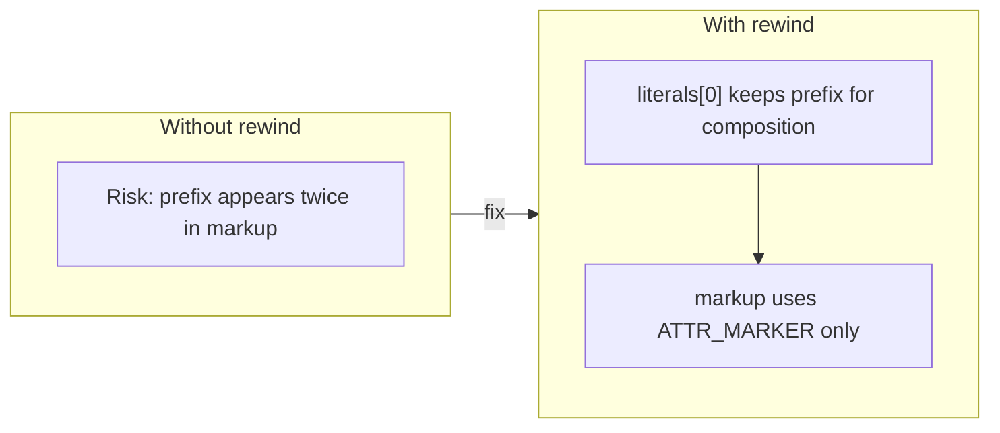
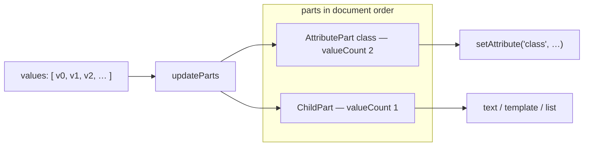

# How attribute compilation works

This doc focuses on **plain attributes** (no `?`/`.`/`@` prefix): values that end up as strings via `setAttribute`. The implementation lives in `compile.ts` (`AttributePart` and `updateParts` in `parts.ts` apply the compiled result at runtime).

If you only read one diagram, use [the state machine](#scanner-two-states) and [the end-to-end pipeline](#end-to-end-pipeline).

---

## Tagged template → what the compiler sees

When you write:

```ts
html`<div class="${a} ${b}" id="x">${label}</div>`;
```

the engine gives `html()` two parallel arrays:

| | |
|---|---|
| `strings` | Static text between each `${...}`, in order |
| `values` | Each expression result, in the same order |

Conceptually, **static** and **dynamic** pieces alternate in source order (conceptually — `strings` holds all static segments; `values` holds each `${...}`):



The compiler **never** looks at `values` while compiling. It only walks `strings` and figures out **how many** consecutive `values` each “part” will need (`valueCount`) and, for attributes, the **static pieces** (`literals`) between them.

---

## End-to-end pipeline



- **Compile** produces a cached `Template` (parsed DOM shape + `PartDescriptor[]`).
- **Instantiate** clones that fragment and binds `Part` instances to real nodes.
- **updateParts** slices `values` according to each part’s `valueCount` (attributes with multiple `${...}` consume more than one value).

---

## Scanner: two states

The attribute logic is a small **finite-state scanner** over the gaps between `strings[i]` and `strings[i+1]` (each gap is “one interpolation will go here”). Think of it like a tokenizer: either you are in normal markup, or inside a quoted attribute value.



Rough meanings:

| State | “We are…” | Next interpolation is… |
|--------|------------|-------------------------|
| **TEXT** | Outside an open quoted attribute value | Either a **child** binding, or the **first** piece of an attribute value (right after `name="`). |
| **ATTR_VALUE** | Inside `name="…` until the matching `"` or `'` | **Another segment of the same attribute** (more static text and/or another `${...}`), until the closing quote. |

The code uses `stepText` / `stepAttrValue` for transitions; see `compile.ts`.

---

## Placeholder markup the HTML parser can eat

Dynamic attribute **values** are not left as real text in the template fragment. The compiler inserts a single fake attribute value **`std-ui-part`** (constant `ATTR_MARKER`) on the element so that, after parsing, the walk can find “this element + attribute name = one AttributePart”. The real string is **rebuilt at runtime** from `literals` + the matching slice of `values`.



So compilation answers: **which element**, **which attribute name**, **which literal segments**, **how many values**.

---

## Example A: two interpolations in one attribute

Template:

```ts
html`<div class="${a} ${b}"></div>`;
```

**Literals** recorded for `class` mirror the static pieces between values: roughly `['', ' ', '']` (empty before first value, space between, empty after second). **valueCount** = 2.



At runtime, `AttributePart` computes:

`class = literals[0] + a + literals[1] + b + literals[2]` → e.g. `"btn active"` if `a === 'btn'`, `b === 'active'`.

---

## Example B: static text before the first `${...}`

Template:

```ts
html`<div class="static-${x}"></div>`;
```

The characters `static-` appear in `strings` **before** the first gap. The scanner stores them in `literals[0]` for composition, but they must **not** stay in the synthetic markup string, or you would get **duplication** when the real value is applied. So when opening the attribute, the compiler **rewinds** the last few characters of the accumulated markup (the length of that prefix) before continuing. That “rewind” is the subtle bit: one copy in `literals`, one placeholder in the parse tree, no double `static-` in the fragment.



---

## Plain vs sigiled attributes

| Style | Example | Compile-time rule |
|--------|----------|-------------------|
| Plain | `class="${a} ${b}"` | Allowed: string composition, multiple `${...}`, static mix. |
| Boolean | `?hidden="${v}"` | Exactly **one** interpolation, **no** extra static text in the value. |
| Property | `.value="${v}"` | Same. |
| Event | `@click="${fn}"` | Same (plus optional `.once`/`.capture`/`.passive` on the **name**). |

Sigiled kinds bind a **single JS value** (boolean, property, listener), not a composed string, so the compiler rejects multiple interpolations or static glue inside the quoted value.

---

## Descriptor → `Part` → DOM

For each attribute binding, `PartDescriptor` carries:

- `kind: 'attr'`, `name` (e.g. `'class'`)
- `literals`: static segments, length = `valueCount + 1`
- `valueCount`: how many entries to take from `values` in order



---

## Files to read in the repo

| File | Role |
|------|------|
| `compile.ts` | Scan `strings`, build synthetic markup, `getTemplate`, `instantiate` |
| `parts.ts` | `AttributePart`, `updateParts` |
| `render.ts` | Root `render()` calling `updateParts` |

---

## Related

- Overview for users: [html.md](./html.md) (binding table, limitations).
- Implementation comments at the top of `compile.ts` and the `ScanState` / `stepText` / `stepAttrValue` helpers.
