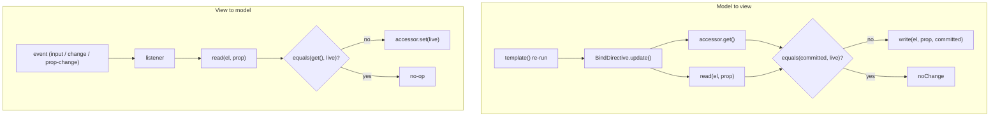

# `bind()` — internal design

Two-way property binding via a **property directive** on `PropertyPart`. For usage and API, see [`README.md`](./README.md).

## Module split

| File | Owns |
|------|------|
| [`core.ts`](./core.ts) | `BindDirective`, `bind()`, `BindOptions`, resolution / defaults. |
| [`index.ts`](./index.ts) | Public re-export. |
| [`bind.test.ts`](./bind.test.ts) | Unit tests through `html()` / `render()`. |
| [`../parts/core.ts`](../../parts/core.ts) | `PropertyPart` directive dispatch (peer to `AttributePart`). |
| [`../../directive.ts`](../../directive.ts) | `PropertyPartInfo`, `PartType.PROPERTY`. |

## Why a property directive

Two-way binding needs the **same element** for both:

- imperative property writes on render (model → view), and
- one stable event listener (view → model).

`AttributePart` and `EventPart` are separate parts; only `PropertyPart` is a single binding site on the element. `bind()` therefore implements `Directive` + `update()` returning `noChange` after doing its own work (same imperative style as `classMap`).

## Data flow

Listener is registered once per binding position (first `update()`), stored on the directive instance, removed in `disconnected()`.

## Live semantics

Default `equals` depends on property + element:

- Native checkbox/radio `.checked` → boolean compare on live `.checked`.
- Native `.value` on `<input>` / `<textarea>` / `<select>` → string compare on live `.value`.
- Everything else → `Object.is` (so missing expando vs initial model still triggers a write).

This mirrors Lit’s `live` on the **down** path only; the **up** path always goes through the configured event.

## Event resolution (`defaultEvent`)

1. Explicit `options.event` wins.
2. Native shortcuts (with element-type checks for `.checked` / `.value`).
3. Fallback `` `${property}-change` ``.

`validateCheckedBindTarget` runs in the directive **constructor**: `.checked` on an `<input>` that is not `checkbox` or `radio` throws; custom elements and non-inputs use `checked-change` instead.

## `PropertyPart` integration

On each `update(values)`:

- If `values[0]` is a `DirectiveResult` → `applyDirective` with `PropertyPartInfo`; on `noChange`, return.
- Otherwise → `disconnect()` any previous directive and fall back to plain `el[prop] = value` (`Object.is` on last committed).

`disconnectRendered()` / `unmount()` call `PropertyPart.disconnect()` → `BindDirective.disconnected()` removes the listener.

## Configuration locking

The first `update()` at a position resolves `event` / `read` / `write` / `equals` and wires the listener; later renders reuse `#resolved` for the listener closure. Changing `event` or hooks mid-lifetime at the same template position is not supported (same as reusing one position with a different directive).

## Comparison with manual `.value` + `@event`

| Concern | Manual | `bind()` |
|---------|--------|----------|
| Listener identity | `EventPart` may replace listener when handler reference changes | one internal listener |
| Property write | `PropertyPart` every time bound value changes | skip when `equals(committed, live)` |
| Boilerplate | two bindings | one |

## Related reading

- [`README.md`](./README.md) — public API and event table.
- [`../directives/design.md`](../design.md) — general directive layout.
- [`../../html.md`](../../html.md#directives) — binding kinds and extension points.
