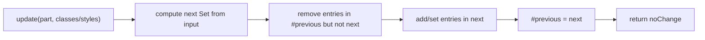

# `classMap` / `styleMap` — internal design

How the two built-in attribute directives are implemented, and how they use the generic
`Directive`/`directive()` protocol. For usage and API, see [`README.md`](./README.md).

## Module split

| File | Owns |
|---|---|
| [`class-map/`](./class-map/) | `ClassMapDirective` + `export const classMap = directive(ClassMapDirective)`. |
| [`style-map/`](./style-map/) | `toCssPropertyName()` (camelCase → kebab-case) + `StyleMapDirective` + `export const styleMap = directive(StyleMapDirective)`. |
| [`index.ts`](./index.ts) | Public re-exports. |
| [`class-map/class-map.test.ts`](./class-map/class-map.test.ts) / [`style-map/style-map.test.ts`](./style-map/style-map.test.ts) | Behavior tests through `AttributePart` directly. |
| [`directives.test.ts`](./directives.test.ts) | End-to-end tests through `t()`/`render()`. |

All code for one directive lives in one file — the constructor's validation, its `update()`
implementation, and its exported `directive()`-made function are never split across modules.
Neither file touches `../parts/` or `../compile.ts`: `AttributePart` has no
built-in knowledge of either directive (or of directives in general beyond the generic dispatch
protocol) — see [`../directive.ts`](../directive.ts).

## Why `update()`, not `render()`

Both directives override only `update(part, ...)`, not `render(...)` — see
[`../directive.ts`](../directive.ts) for the general distinction, but concretely
here: `render()` would have to return a single string for `AttributePart` to commit via
`setAttribute`, which means **replacing the whole attribute** every render. That's wrong for both:

- `classMap`/`styleMap` need to **diff** against what they themselves set last time, so they only
  add/remove the classes or properties that actually changed — not touch classes/properties set by
  static markup or anything else.
- A single composed string can't express "leave everything else on this element alone."

So both override `update()` instead, mutate `part.element` directly (`classList`/`style`), and
return `noChange` to tell `AttributePart` there's nothing left for it to commit.

## Shared shape

Both directives follow the identical pattern:

1. **Constructor** validates `partInfo.type === PartType.ATTRIBUTE` and the specific attribute
   name (`'class'` / `'style'`), throwing otherwise. This runs once, the first time the directive
   is used at a given binding position (see `applyDirective()` in `directive.ts`).
2. **One private field** (`#previous: Set<string> | undefined`) holds what this *instance* applied
   last render — the class names, or the CSS property names. Because one `Directive` instance is
   reused across re-renders at the same position, this field is exactly where "what did I do last
   time" state belongs; no external cache is needed.
3. **`update()`** computes the new set, diffs it against `#previous` (removing whatever dropped
   out, adding/setting whatever is new or changed), stores the new set as `#previous`, and returns
   `noChange`.

## `classMap` specifics

- `next` is the set of keys whose value is truthy (`Object.keys(classes).filter(key =>
  Boolean(classes[key]))`).
- Removal/addition go through `part.element.classList.remove`/`.add`.
- A class already present on the element from elsewhere (static markup, another directive, etc.)
  is never touched — `classMap` only ever removes classes it itself previously added.

## `styleMap` specifics

- Input keys may be camelCase (`fontSize`) or already kebab-case/custom properties (`--my-color`);
  `toCssPropertyName()` converts the former (`/[A-Z]/g` → `-` + lowercase) and passes the rest
  through unchanged, matching what `CSSStyleDeclaration.setProperty` expects.
- A value of `null`/`undefined` means "don't set this property this render" — it's simply skipped
  when building `next`, so it falls out via the normal removal diff if it was set last time.
- Everything else is stringified (`String(value)`) and applied via `style.setProperty`.
- `part.element` is cast to `HTMLElement | SVGElement` to access `.style` — `Element` itself
  doesn't have it, but both directives only ever see elements with inline style support in
  practice (the directive is only usable on the `style` attribute to begin with).

## Related reading

- [`README.md`](./README.md) — public API and examples.
- [`../directive.ts`](../directive.ts) — the generic `Directive`/`directive()`/`PartType`/`noChange` protocol both directives are built on.
- [`../html.md`](../html.md#directives) — "Directives" section: how to write a custom one (attribute or child).
- [`./unsafe-html/`](./unsafe-html/) — built-in **child** directive `html()` (uses `commitWith()`).
- [`./map-by-key/`](./map-by-key/) — built-in **child** directive `mapByKey()` (keyed lists); see [`./map-by-key/design.md`](./map-by-key/design.md).
- [`class-map/class-map.test.ts`](./class-map/class-map.test.ts) / [`style-map/style-map.test.ts`](./style-map/style-map.test.ts) / [`directives.test.ts`](./directives.test.ts) — behavior tests.
